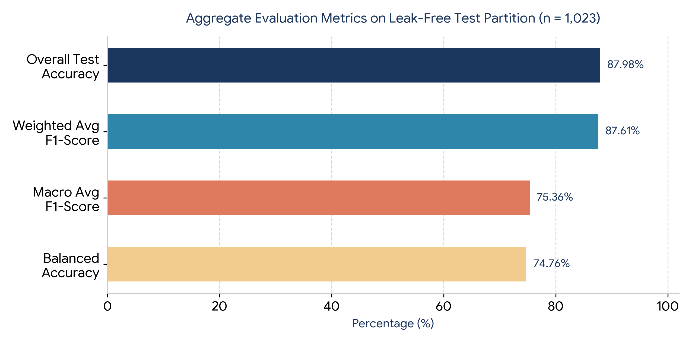
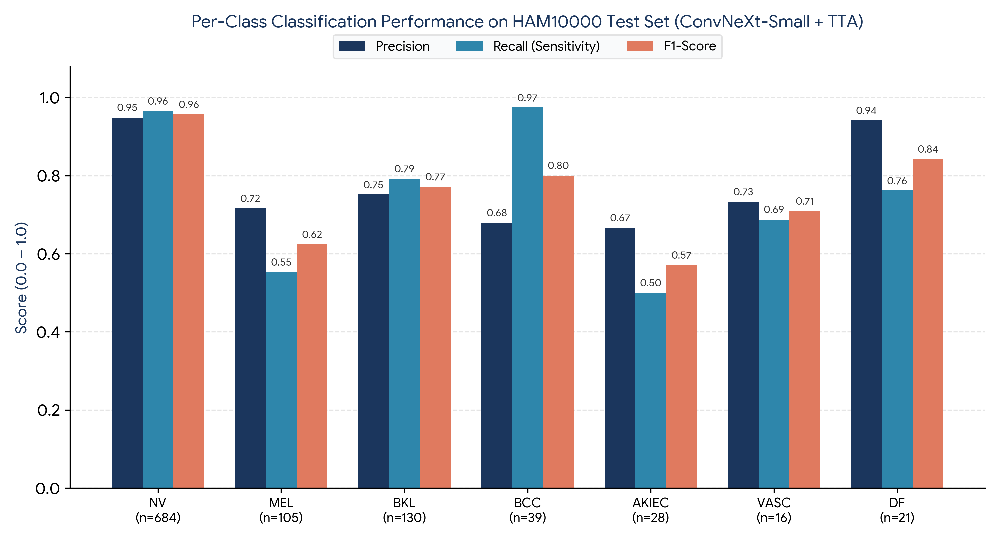
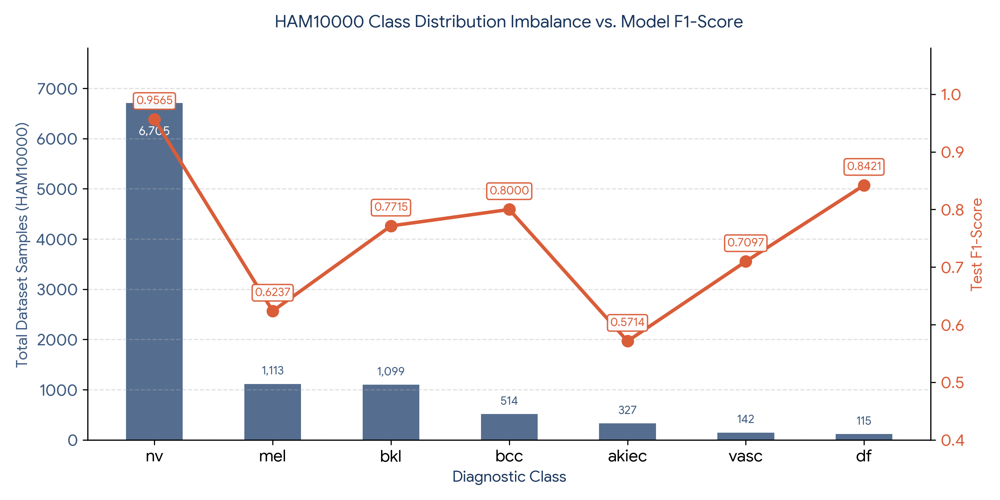

# Automated Skin Disease Classification Using Deep Learning

A deep learning project developed for the **5th Semester Curriculum** in the **Department of Information Technology, Jalpaiguri Government Engineering College (JGEC)**, focusing on multi-class dermatoscopic lesion diagnosis using modern convolutional vision backbones, leak-free validation strategies, and test-time augmentation.

---

## 👨‍🎓 Authors & Academic Details

- **Institution:** Jalpaiguri Government Engineering College (JGEC), West Bengal, India
- **Department & Semester:** Department of Information Technology — 5th Semester Curriculum Project
- **Submitted by:**
  - **Anurag Saha** — Roll No: `24101106037`
  - **Ayan Karak** — Roll No: `24101106013`
- **Submitted to & Supervised by:** **Dr. Somnath Dhibar** (Project Mentor & Evaluator)

---

## 📊 Project Overview

Dermatological condition diagnosis from skin lesion imagery often suffers from high visual ambiguity and severe inter-class imbalance. This project implements an end-to-end, leakage-free computer vision pipeline trained on the **HAM10000** (*Human Against Machine with 10000 training images*) dataset (10,015 dermatoscopic images) to categorize skin lesions into seven distinct diagnostic classes.

### Target Classes:
1. **nv** — Melanocytic nevi (6,705 images)
2. **mel** — Melanoma (1,113 images)
3. **bkl** — Benign keratosis-like lesions (1,099 images)
4. **bcc** — Basal cell carcinoma (514 images)
5. **akiec** — Actinic keratoses and intraepithelial carcinoma (327 images)
6. **vasc** — Vascular lesions (142 images)
7. **df** — Dermatofibroma (115 images)

---

## 🧠 Key Technical Highlights

- **Leak-Free Data Splitting:** Implemented `StratifiedGroupKFold` grouped strictly by patient lesion ID (`lesion_id`). This guarantees that multiple images of the exact same physical lesion never cross between the training, validation, and test partitions ($n = 1,023$ unseen test images).
- **Architecture:** Utilized `convnext_small.fb_in22k_ft_in1k` pretrained via `timm` with custom dropout ($p=0.3$) for multi-scale border and pigment network feature representation.
- **Data Augmentation:** Configured an Albumentations pipeline including horizontal/vertical flips, 90-degree rotations, `ShiftScaleRotate`, and `ColorJitter`.
- **Optimization & Regularization:**
  - Label Smoothing Cross-Entropy Loss ($\epsilon=0.1$) to prevent overconfident logits on visually ambiguous lesions.
  - AdamW optimizer combined with a `CosineAnnealingLR` scheduler.
  - Mixed-precision training via PyTorch AMP (`torch.amp.autocast` & `GradScaler`) for efficient GPU memory utilization.
- **Inference Enhancement:** Implemented multi-view Test-Time Augmentation (TTA) averaging softmax predictions across original, horizontally flipped, and vertically flipped views.

---

## 📈 Experimental Results

### Overall Test Performance ($n = 1,023$ Lesion-Disjoint Test Set)

| Metric | Score |
| :--- | :--- |
| **Overall Test Accuracy** | **87.98%** |
| **Weighted Average F1-Score** | **0.8761** |
| **Macro Average F1-Score** | **0.7534** |
| **Balanced Accuracy** | **74.76%** |

### Per-Class Classification Report

| Class | Diagnostic Name | Precision | Recall | F1-Score | Support |
| :--- | :--- | :---: | :---: | :---: | :---: |
| **nv** | Melanocytic nevi | 0.9483 | 0.9649 | 0.9565 | 684 |
| **mel** | Melanoma | 0.7160 | 0.5524 | 0.6237 | 105 |
| **bkl** | Benign keratosis-like lesions | 0.7518 | 0.7923 | 0.7715 | 130 |
| **bcc** | Basal cell carcinoma | 0.6786 | 0.9744 | 0.8000 | 39 |
| **akiec** | Actinic keratoses & intraepithelial carcinoma | 0.6667 | 0.5000 | 0.5714 | 28 |
| **vasc** | Vascular lesions | 0.7333 | 0.6875 | 0.7097 | 16 |
| **df** | Dermatofibroma | 0.9412 | 0.7619 | 0.8421 | 21 |

### Performance Charts

#### Aggregate Metrics



#### Per-Class Metrics



#### Class Imbalance vs. F1-Score



> Full official LaTeX project reports and section-wise documentation are included in the repository (`00_Complete_Official_Project_Report_JGEC.tex` through `05_Conclusion_and_Future_Scope_Skin_Disease_Classification_JGEC.tex`).

---

## 🛠️ Tech Stack & Requirements

- **Language:** Python 3.10+
- **Deep Learning Framework:** PyTorch, Torchvision
- **Model Hub:** `timm` (PyTorch Image Models)
- **Image Processing & Augmentation:** Albumentations, OpenCV
- **Data Handling & Metrics:** NumPy, Pandas, Scikit-learn
- **Hardware:** NVIDIA GPU with CUDA support recommended for training

## 📂 Repository Structure

```text
├── skin.ipynb
├── requirements.txt
├── README.md
├── 00_Complete_Official_Project_Report_JGEC.tex
├── 01_Summary_Skin_Disease_Classification_JGEC.tex
├── 02_Literature_Survey_Skin_Disease_Classification_JGEC.tex
├── 03_Proposed_Method_Skin_Disease_Classification_JGEC.tex
├── 04_Performance_Chart_Analysis_Skin_Disease_Classification_JGEC.tex
├── 05_Conclusion_and_Future_Scope_Skin_Disease_Classification_JGEC.tex
└── Performance_Charts/
    ├── chart_aggregate_metrics.png
    ├── chart_per_class_metrics.png
    └── chart_imbalance_vs_f1.png
```

---

## 🚀 Setup & Installation

### 1. Clone the Repository

```bash
git clone https://github.com/sahaanurag207-oss/SKIN-DISEASE-CLASSIFICATION-FROM-IMAGES.git
cd SKIN-DISEASE-CLASSIFICATION-FROM-IMAGES
```

### 2. Create a Virtual Environment (Recommended)

Using `venv`:
```bash
python -m venv venv

# Activate on Windows:
venv\Scripts\activate

# Activate on Linux / macOS:
source venv/bin/activate
```

Or using `conda`:
```bash
conda create -n skin-disease python=3.10 -y
conda activate skin-disease
```

### 3. Install PyTorch (with CUDA Support)

Install PyTorch matching your system's CUDA version from the [official PyTorch website](https://pytorch.org/get-started/locally/). For example, for CUDA 12.1:

```bash
pip install torch torchvision --index-url https://download.pytorch.org/whl/cu121
```

*(For CPU-only execution, run `pip install torch torchvision`.)*

### 4. Install Project Dependencies

Install all required packages using the provided `requirements.txt`:

```bash
pip install -r requirements.txt
```

### 5. Dataset Preparation

1. Download the **HAM10000** dataset (`HAM10000_metadata.csv` and image folders `HAM10000_images_part_1` / `HAM10000_images_part_2`) from the [project dataset link](https://share.google/BKuGoG9tJ6k4HAIBd).
2. Extract the archive into a local `data/` directory inside the repository root (or update the dataset path variable in the first configuration cell of `skin.ipynb`).

### 6. Run the Notebook

Launch Jupyter Notebook or JupyterLab and execute the cells sequentially:

```bash
jupyter notebook skin.ipynb
```

---

## 🙏 Acknowledgment

We express our sincere gratitude to **Dr. Somnath Dhibar**, Department of Information Technology, Jalpaiguri Government Engineering College (JGEC), to whom this project is formally submitted. His continuous guidance, technical mentorship, and constructive feedback were instrumental in helping us design, refine, and build this deep learning system.
